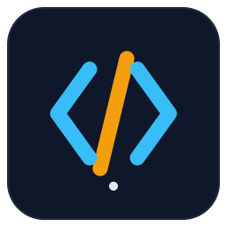

<p align="center">
  
</p>

# SQL Glyph

**Convert, format, and inspect SQL across 16 dialects — locally.**

SQL Glyph is a VS Code extension for moving SQL between databases. It parses your SQL into a syntax tree, generates the target dialect, explains what changed, flags compatibility risks, and shows a native diff. Everything runs on your machine. No database connection, no query execution, no telemetry.

## What you can do

- **Convert SQL between 16 dialects.** Work on a selection or a whole file, with multi-statement support and optional pretty printing.
- **Format SQL in place.** Normalize layout without changing the dialect.
- **See exactly what changed.** A native diff editor compares the original and converted SQL side by side.
- **Understand the rewrite.** The Conversion Analysis panel lists compatibility diagnostics, rule-based transformation explanations, and line-level changes.
- **Catch problems before they reach a database.** Warnings and unsupported cases are separated, and generated SQL is parsed back with the target grammar to confirm it is syntactically valid.
- **Keep going when one statement fails.** Successful statements are returned with per-statement errors instead of discarding the whole file.
- **Inspect the parse tree.** The AST Explorer shows nodes, properties, generated SQL, comments, and source locations with a Reveal action.
- **Stay in the editor.** Quick Fix actions, CodeLens shortcuts, Problems panel diagnostics, and a dedicated sidebar put the workflow next to your SQL.

## Supported dialects

PostgreSQL, MySQL, Microsoft SQL Server (T-SQL), Snowflake, Google BigQuery, Oracle Database, SQLite, DuckDB, Spark SQL, Trino, Amazon Redshift, ClickHouse, Databricks SQL, Apache Hive, Presto, and Teradata.

SQL Glyph is a syntax transpiler and analyzer. It does not connect to a database, execute queries, or verify semantic equivalence.

## Getting started

1. Install the extension and reload VS Code.
2. Run **SQL Glyph: Set Up Local Engine** and choose a Python 3.9+ interpreter. SQL Glyph creates a private environment and installs SQLGlot there.
   - Already have SQLGlot? Point `sqlGlyph.pythonPath` at that interpreter instead.
3. Open a `.sql` file and run **SQL Glyph: Convert Entire File** or select SQL and run **SQL Glyph: Convert Selected SQL**.

The setup flow asks before creating an environment and before installing anything. Network access is only used for that explicit install.

## Commands

| Command | What it does |
| --- | --- |
| **SQL Glyph: Convert Selected SQL** | Convert the selection and open a diff |
| **SQL Glyph: Convert Entire File** | Convert the whole document |
| **SQL Glyph: Convert to Target Dialect** | Convert the selection or file to the configured target |
| **SQL Glyph: Format SQL** | Format the selection or file |
| **SQL Glyph: Inspect AST** | Parse the selection or file and open the AST Explorer |
| **SQL Glyph: Compare Dialects** | Convert and open the analysis panel plus diff |
| **SQL Glyph: Show Conversion Analysis** | Reopen the analysis panel for the last conversion |
| **SQL Glyph: Copy Converted SQL** | Copy the last result to the clipboard |
| **SQL Glyph: Show Conversion Diff** | Reopen the diff for the last conversion |
| **SQL Glyph: Select Source Dialect** | Choose a source dialect or Auto Detect |
| **SQL Glyph: Select Target Dialect** | Choose the target dialect |
| **SQL Glyph: Open Conversion Panel** | Focus the SQL Glyph sidebar |
| **SQL Glyph: Set Up Local Engine** | Create or repair the local Python environment |
| **SQL Glyph: Show Engine Output** | Open the engine log |

Commands are available from the Command Palette, the SQL editor context menu, the editor title bar, and the SQL Glyph sidebar.

## Working with results

### Convert and review

1. Open a SQL file and select part of it, or select nothing to use the whole file.
2. Run a convert command.
3. Review the diff, the analysis panel, or the Problems panel.
4. Copy the result, open it in a new editor, save it as a new file, or replace the source.

**Replace** always asks for confirmation, checks that the source text has not changed since conversion, applies a normal undoable edit, and clears stale diagnostics. The last conversion is restored when you reopen the workspace.

### Partial results

If one statement in a multi-statement file cannot be parsed or generated, SQL Glyph keeps the statements that succeeded and reports the failing statement separately. The result is marked **Unsupported**, and the analysis panel and Problems panel identify the statement and location that need attention.

### Round-trip check

After generating the target SQL, SQL Glyph parses it again with the target grammar. If the generated SQL does not parse back, the result is marked **Unsupported** with a round-trip diagnostic. This is a syntax check only; it does not prove the query returns the same rows.

### Source dialect detection

When the source is set to `auto`, SQL Glyph scores dialect-specific markers and parseability:

- High confidence proceeds with a notification.
- Medium or low confidence opens a picker with the candidate dialects and evidence.
- No markers means you are asked to choose. SQL Glyph never silently assumes an ambiguous dialect.

Detection is a heuristic. Confirm the source dialect when precision matters.

### AST Explorer

The AST Explorer shows the parse tree with node types, labels, grouped child roles, primitive properties, comments, generated SQL, and source spans. Search filters across types, labels, properties, and SQL. Very large trees are truncated with an explicit notice.

### Analysis panel

The analysis panel separates:

- **Diagnostics** — compatibility risks and errors with category, rule ID, confidence, and source location.
- **Transformations** — observed rewrites with the original and converted snippet, a rule-based explanation when available, and `unexplained` when not.
- **Diff** — a line-level comparison of input and output.
- **Metadata** — dialect pair, statement counts, partial/round-trip status, elapsed time, versions, and the explicit flags `executed: false`, `databaseConnected: false`, and `semanticallyVerified: false`.

## Status and diagnostics

| Status | Meaning |
| --- | --- |
| **Success** | SQL parsed and generated with no compatibility diagnostics. This still does not prove semantic equivalence. |
| **Warning** | SQL was generated, but one or more compatibility risks were detected. Review before use. |
| **Unsupported** | Output is known to be invalid for the target, a statement could not be converted, or the round-trip check failed. Review before use. |

A response can be successful at the protocol level while the overall status is **Unsupported**. This lets the extension show the generated SQL alongside the reason it is unsafe.

## Configuration

| Setting | Default | Description |
| --- | --- | --- |
| `sqlGlyph.pythonPath` | `""` | Path to a Python 3.9+ interpreter. Empty uses the managed environment or a detected interpreter. |
| `sqlGlyph.defaultSourceDialect` | `auto` | Source dialect, or conservative auto detection. |
| `sqlGlyph.defaultTargetDialect` | `bigquery` | Target dialect. |
| `sqlGlyph.prettyPrint` | `true` | Pretty-print generated SQL. |
| `sqlGlyph.maxSqlSizeKb` | `2048` | Maximum input size. The engine enforces a 10 MB hard limit. |
| `sqlGlyph.engineTimeoutMs` | `30000` | Timeout for one engine request. |
| `sqlGlyph.showConversionDiagnostics` | `true` | Publish conversion diagnostics to the Problems panel. |
| `sqlGlyph.autoDetectBehavior` | `notify` | Proceed on high confidence (`notify`) or always ask (`alwaysAsk`). |
| `sqlGlyph.codeLens.enabled` | `true` | Show Convert and Format CodeLens actions at the top of SQL files. |

## Privacy

- SQL is processed by a local Python subprocess. It is never uploaded.
- The engine has no database code, no network code, and no query execution code.
- No telemetry is collected.
- The only network access is the explicit `pip install` performed by **Set Up Local Engine**.
- Setup is disabled in untrusted workspaces. Conversion can still use an already-installed engine.
- Webviews use a strict Content Security Policy and local resources only.

## Limitations

SQL Glyph is a syntax transpiler and analyzer, not a migration validator.

- **No execution and no semantic verification.** Generated SQL is never run or compared against a database.
- **SQLGlot coverage is finite.** Vendor-specific syntax, user-defined functions, extensions, and newer features may be parsed as anonymous functions or rejected.
- **Not every rewrite is valid for the target.** Known cases are flagged, but the rules are conservative and incomplete.
- **Auto detection is heuristic.** Shared syntax is common; confirm when precision matters.
- **Session state is not simulated.** Temporary tables, variables, transactions, and DDL dependencies are not tracked.
- **Comments and formatting can move.** SQLGlot may reorder or normalize whitespace and comments.
- **Statement splitting is SQLGlot's.** Batch separators such as T-SQL `GO` are not treated as session boundaries.
- **Size limits.** The default input limit is 2 MB; the hard limit is 10 MB.

If a conversion matters, review the analysis panel and test the generated SQL against the target database in your normal migration workflow.

## Documentation

- **[High-level workflow](https://github.com/samwilson129/SQL-glyph/blob/main/docs/HIGH_LEVEL_WORKFLOW.md)** — how SQL Glyph is put together, the conversion pipeline, layer ownership, guarantees, and failure handling.
- **[In-depth pipeline workflow](https://github.com/samwilson129/SQL-glyph/blob/main/docs/IN_DEPTH_WORKFLOW.md)** — the code-level walkthrough for contributors: activation, commands, detection, engine lifecycle, transport, protocol dispatch, parsing, generation, diagnostics, AST serialization, span mapping, webviews, persistence, caching, and packaging.

## Requirements

- VS Code **1.90 or newer**
- Python **3.9 or newer** for the local engine
- SQLGlot **30.31.0** (installed by setup or supplied by your interpreter)

## Development

```bash
npm ci
npm run compile        # typecheck + esbuild bundle
npm test               # Python + unit + real-engine integration tests
npm run test:coverage  # coverage for both layers
npm run package:vsix   # produce the extension package
```

Architecture, process topology, protocol details, and the full test matrix live in the two workflow guides above.

## Troubleshooting

**“No Python 3.9+ interpreter was found.”**
Install Python 3.9+, put it on `PATH`, set `sqlGlyph.pythonPath`, or run **Set Up Local Engine** and browse for the interpreter.

**“SQLGlot is not installed.”**
Run **SQL Glyph: Set Up Local Engine**. SQL Glyph never installs packages into an existing interpreter silently.

**The engine times out.**
Increase `sqlGlyph.engineTimeoutMs`, convert a smaller selection, or check **Show Engine Output**. A timed-out request restarts the engine process.

**A conversion is marked Unsupported.**
Open **Show Conversion Analysis**, read the error diagnostics, and review the generated SQL manually. SQL Glyph intentionally does not hide or silently “fix” invalid output.

**Setup cannot reach PyPI.**
Configure your normal proxy environment variables or point `sqlGlyph.pythonPath` at an interpreter where SQLGlot 30.31.0 is already installed.

## Contributing and security

See [CONTRIBUTING.md](https://github.com/samwilson129/SQL-glyph/blob/main/CONTRIBUTING.md) for development and pull request guidance. Report security issues privately as described in [SECURITY.md](https://github.com/samwilson129/SQL-glyph/blob/main/SECURITY.md).

## License

MIT. See the `LICENSE` file included with the extension.

SQL Glyph is an independent project. SQLGlot is a separate open-source project with its own license.
