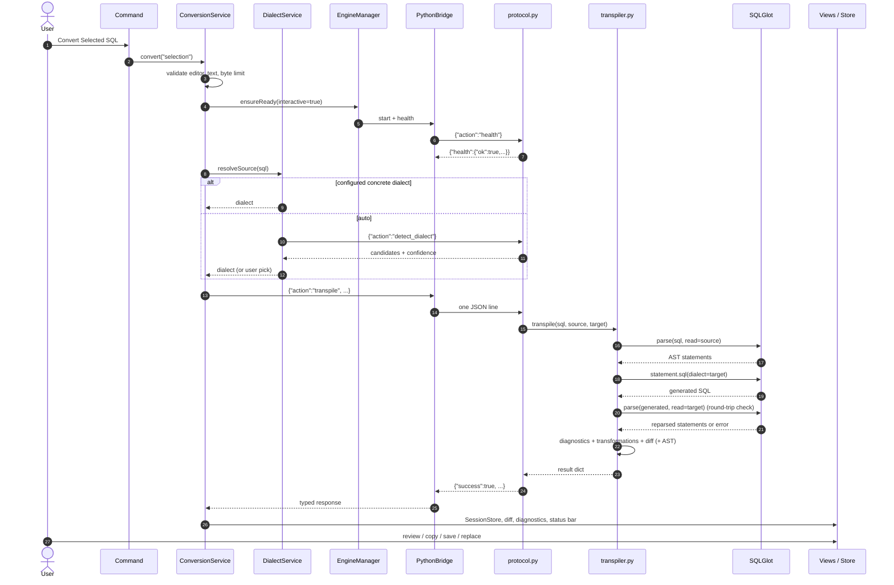

# SQL Glyph: High-Level Workflow

<p align="center">
  
</p>

This is the quick mental model for how SQL Glyph turns a selection of SQL into a
reviewable conversion. It covers the shape of the system, the order of
operations, who owns each decision, and what the result does and does not mean.

For the code-level walkthrough (exact functions, data shapes, limits, and
failure handling), see [IN_DEPTH_WORKFLOW.md](./IN_DEPTH_WORKFLOW.md).

---

## 1. What SQL Glyph is

SQL Glyph is a **local-first VS Code extension**. It parses SQL into an abstract
syntax tree (AST) with [SQLGlot](https://github.com/tobymao/sqlglot), generates
the same statement in another dialect, and then explains what changed.

It is deliberately two processes:

| Process | Language | Job |
| --- | --- | --- |
| VS Code extension host | TypeScript | Commands, editor state, webviews, diagnostics, diff, process lifecycle |
| Local SQL engine | Python 3.9+ | Parsing, generation, detection, diagnostics, transformation rules, AST serialization |

The Python process is a child of the extension. It has **no database driver, no
network code, and no SQL execution path**. Communication is newline-delimited
JSON on `stdin`/`stdout`.

```text
┌──────────────────────────── VS Code extension host ────────────────────────────┐
│                                                                                 │
│  commands ──► services ──► EngineManager ──► PythonBridge ──► stdin            │
│                    │                              ▲                             │
│                    ▼                              │                             │
│              SessionStore ◄── results ◄───────────┘ stdout                     │
│                    │                                                            │
│        ┌───────────┼────────────┬──────────────┬───────────────┬────────────┐   │
│        ▼           ▼            ▼              ▼               ▼            ▼   │
│   Conversion     AST         Analysis       Status bar     Problems     CodeLens│
│   sidebar        sidebar     panel          item           panel        / QuickFix│
│                                                                                 │
└─────────────────────────────────────────────────────────────────────────────────┘
                                     │ JSON Lines
                                     ▼
┌──────────────────────────── Local Python engine ───────────────────────────────┐
│                                                                                 │
│  main.py ──► protocol.py ──► transpiler.py ──► parser.py ──► SQLGlot AST        │
│                   │              │                  │                           │
│                   │              ├──► diagnostics.py    (compatibility rules)  │
│                   │              ├──► explanations.py   (transformation rules) │
│                   │              ├──► diff.py           (line diff)            │
│                   │              └──► ast_serializer.py (safe tree + spans)    │
│                   │                                                            │
│                   └──► detection.py (heuristic source dialect)                 │
│                                                                                 │
└─────────────────────────────────────────────────────────────────────────────────┘
```

---

## 2. The pipeline at a glance

```mermaid
flowchart LR
    A[User selects SQL and target dialect] --> B[VS Code command]
    B --> C[Conversion service: collect and validate input]
    C --> D{Source dialect configured?}
    D -->|Explicit| E[Use selected source dialect]
    D -->|Auto| F[Python engine detects candidates]
    F --> G{High-confidence result?}
    G -->|Yes, unless alwaysAsk| E
    G -->|No / alwaysAsk| H[Ask user to confirm source]
    H --> E
    E --> I[Engine manager starts or reuses local Python process]
    I --> J[JSON Lines request over stdin]
    J --> K[Validate request and parse SQL with SQLGlot]
    K --> L[Generate SQL in target dialect]
    L --> R[Parse generated SQL back with the target grammar]
    R --> M[Analyze diagnostics, transformations, optional AST]
    M --> N[Structured JSON response over stdout]
    N --> O[Show diff, diagnostics, explanations, metadata in VS Code]
    O --> P[User reviews, copies, saves, or explicitly replaces source]
```



The same flow as a sequence:



---

## 3. The seven stages

### Stage 1: User action

A command starts the flow: **Convert Selected SQL**, **Convert Entire File**,
**Convert to Target Dialect**, **Format SQL**, **Compare Dialects**, or
**Inspect AST**. CodeLens actions at the top of a SQL file and Quick Fix actions
on SQL Glyph diagnostics invoke the same commands. Commands are thin. They
delegate to a service and do not parse or rewrite SQL themselves.

### Stage 2: Input collection and validation

The service reads the active editor, takes the selection or the whole document,
and rejects empty input, missing editors, and input over the configured byte
limit before any process work begins. For a selection it records the document
offset where the SQL starts; that offset is needed later to map engine spans
back to the right characters.

### Stage 3: Dialect resolution

The target is always a concrete dialect. The source may be:

- a configured concrete dialect, used directly; or
- `auto`, in which case the engine scores dialect markers and parseability and
  returns candidates, evidence, and confidence.

A high-confidence result proceeds unless `alwaysAsk` is set. Medium and low
confidence always prompt. **`auto` never reaches the engine's `transpile`
action**, and the protocol rejects it, so the UI cannot silently skip confirmation.

### Stage 4: Engine readiness

`EngineManager` finds a Python 3.9+ interpreter (configured path → managed venv
→ `PATH`), starts `sql-engine/main.py` if needed, and sends a `health` request.
The result is a small state machine: `unconfigured`, `starting`, `ready`,
`missing-dependency`, `error`, or `stopped`.

Setup is explicit. SQL Glyph never installs Python packages silently; the user
confirms the venv path and `sqlglot==30.31.0` before `pip` runs.

### Stage 5: Parse, generate, analyze

Inside Python, `transpile()` does one pass:

1. **Parse** the source with the chosen dialect. Empty input, oversized input,
   and parser errors become structured engine errors. In a multi-statement file,
   a failing statement becomes a per-statement error while the remaining
   statements continue.
2. **Generate** each statement in the target dialect. Generation failures are
   also isolated per statement.
3. **Verify** each generated statement by parsing it back with the target
   grammar. A failure becomes a round-trip diagnostic.
4. **Diagnose** compatibility risks from the source AST and the generated text.
5. **Explain** structural rewrites by rendering nodes in both dialects.
6. **Diff** the original and generated text line by line.
7. Optionally **serialize** the AST into a bounded, frontend-safe tree.

If every statement fails, the request returns the usual structured error
envelope. If some succeed, the response contains the successful output, a
`statementErrors` list, and an overall status of **Unsupported**.

### Stage 6: Response and rendering

The engine writes one compact JSON line. The bridge matches it to the request by
id and resolves the promise. `ConversionService` checks a small in-memory cache
for an identical SQL/dialect/version request, stores the outcome, publishes
diagnostics to the Problems panel, updates the status bar, opens a native diff,
and shows a notification.

The last conversion is persisted in workspace state so reopening the workspace
restores the analysis panel and review actions. The AST is not persisted.

### Stage 7: Review and explicit mutation

Everything after the response is a review surface. Copy, open, save-as, and
replace are separate actions. **Replace** re-reads the document, checks that the
original text is still exactly what was converted, asks for modal confirmation,
then applies a normal undoable edit.

---

## 3.1 Cross-cutting behavior

- **Progress and cancellation.** Long conversions show a cancellable progress
  notification. Because the bridge sends one request at a time, cancelling the
  active request terminates the engine process; the next request starts a fresh
  one.
- **Caching.** Successful `transpile` and `format` results are cached in memory.
  The key includes a SHA-256 of the SQL, both dialects, the pretty flag, the
  action, and the SQLGlot version. Unsupported results are never cached.
- **Persistence.** Only the conversion outcome is stored in `workspaceState`.
  Restoring it does not bypass the replace guard, which still compares live
  document text.
- **Formatting.** Format uses the same engine path as conversion with the source
  and target set to the same dialect.

---

## 4. Who owns what

| Layer | Main files | Owns |
| --- | --- | --- |
| Activation | `src/extension.ts` | Composition root; constructs and wires every service |
| Commands | `src/commands/registerCommands.ts` | Palette/menu entry points and the top-level error guard |
| Engine lifecycle | `src/engine/engineManager.ts` | Readiness state machine, restart, health |
| Python discovery | `src/engine/pythonDiscovery.ts` | Candidate interpreters, version probing |
| Python setup | `src/engine/pythonEnvironment.ts` | Managed venv, pinned SQLGlot install, trust checks |
| Transport | `src/engine/pythonBridge.ts`, `jsonLines.ts` | Spawn, JSONL framing, queue, timeouts, exit handling |
| Services | `src/services/*.ts` | Conversion, AST, dialects, diagnostics, previews, conversion cache |
| State | `src/state/sessionStore.ts` | Last conversion/AST, change events, workspace-state persistence |
| Providers | `src/providers/*.ts` | CodeLens shortcuts and Quick Fix actions |
| Views | `src/views/*.ts`, `src/webview/html.ts` | Sidebars, analysis panel, status bar, CSP, shared logo header |
| Types | `src/types/*.ts` | Protocol, dialect, AST, diagnostic, conversion shapes |
| Engine entry | `sql-engine/main.py` | `sys.path` setup and protocol start |
| Protocol | `sql-engine/sqlglyph/protocol.py` | Validation, dispatch, response envelope |
| Engine logic | `parser.py`, `transpiler.py`, `detection.py` | Parse, generate, detect |
| Analysis | `diagnostics.py`, `explanations.py`, `diff.py` | Compatibility rules, rewrite rules, line diff |
| AST | `ast_serializer.py`, `positions.py` | Safe tree and UTF-16 spans |

The split is intentional: **the Python engine is authoritative** for dialect
capabilities, diagnostics, transformation rules, detection, and AST
serialization. TypeScript mirrors display metadata and owns everything that
touches VS Code.

---

## 5. What the pipeline guarantees, and what it does not

Three different levels of confidence are easy to conflate:

| Level | Meaning | Who provides it |
| --- | --- | --- |
| **Parseable** | SQLGlot recognized the input under the chosen source grammar | SQLGlot parser |
| **Generated** | SQLGlot emitted text for the requested target dialect | SQLGlot generator |
| **Behavior-preserving** | The target database accepts the SQL and produces the intended results | Nobody. You must verify |

SQL Glyph directly supports the first two. It provides diagnostics and
explanations to help with the third, but **it never establishes it**. A
conversion can be `success: true` at the protocol level and still carry an
overall status of `unsupported` because a rule found a construct the target
likely rejects.

Diagnostics and transformation explanations are review aids, not a database
execution or formal-equivalence result.

---

## 6. Status and uncertainty

The overall status is derived, not asserted:

```python
def _status(diagnostics):
    if any(item["severity"] == "error" for item in diagnostics):
        return "unsupported"
    if any(item["severity"] == "warning" for item in diagnostics):
        return "warning"
    return "success"
```

- **SUCCESS**: parsed and generated, no compatibility diagnostics.
- **WARNING**: generated, but at least one risk needs review.
- **UNSUPPORTED**: generated output is known to be invalid/unsupported for the
  target, or the request failed.

Transformation explanations follow the same honesty rule. A rewrite either
matches a known rule or is reported as `unexplained`. SQL Glyph never invents a
reason for a difference it does not recognize.

---

## 7. Failure summary

| Failure | Detected by | Effect |
| --- | --- | --- |
| No editor, empty input, oversized input | Conversion service | Stop before the request; user-facing message |
| Ambiguous / low-confidence source | Dialect service | Ask the user; never proceed on a guess |
| Python missing | Environment / engine manager | Mark `unconfigured`; offer setup when interactive |
| SQLGlot missing | Health check | Mark `missing-dependency`; explicit setup only |
| Invalid protocol payload | Python protocol layer | Structured `INVALID_REQUEST` / `UNKNOWN_ACTION` |
| Parse failure | Parser | `PARSE_ERROR` with line/column/context; per-statement errors when other statements parse |
| Generation failure | Transpiler | `GENERATION_ERROR` with statement index; per-statement errors when other statements generate |
| Round-trip failure | Transpiler | Error diagnostic; overall status `unsupported` |
| Request timeout | Python bridge | Reject; an active-request timeout kills the process |
| Cancellation | Progress token / bridge | `ABORTED`; an active request restarts the engine |
| Process exit | Bridge / engine manager | Fail pending work; next request restarts |

The extension's command guard catches anything that escapes, logs the stack to
the **SQL Glyph** output channel, and offers **Set Up Engine** or **Show Output**.

---

## 8. Design principles

- **Local processing.** SQL is parsed in a local subprocess. There is no hosted
  translation service, no telemetry, and no database connection.
- **AST-powered, not regex-powered.** Every conversion is parsed and generated
  by SQLGlot.
- **Explicit dialects.** `auto` is a source-selection convenience; the engine
  receives a concrete dialect.
- **Review before replacement.** Replacing source is a separate, modal,
  undoable operation guarded by a content check.
- **Structured uncertainty.** Known rewrites get explanations; unknown ones stay
  unexplained.
- **No silent assumptions.** Ambiguous detection always prompts.
- **No session simulation.** Statements are converted independently; temporary
  tables, variables, transactions, and DDL dependencies are not tracked.
- **Bounded payloads.** Diagnostics, transformations, diff rows, AST nodes,
  depth, and snippet sizes all have explicit caps.
- **Partial over all-or-nothing.** One bad statement does not discard the
  statements that converted successfully.
- **Syntax checked twice.** Generated SQL is parsed back with the target
  grammar before it is presented as usable.

---

## 9. Where to go next

| If you want to… | Read |
| --- | --- |
| Understand the exact code path | [IN_DEPTH_WORKFLOW.md](./IN_DEPTH_WORKFLOW.md) |
| See user-facing behavior and settings | [../README.md](../README.md) |
| Change a dialect rule | `sql-engine/sqlglyph/diagnostics.py`, `explanations.py` |
| Change the wire format | `src/types/protocol.ts`, `sql-engine/sqlglyph/protocol.py` |
| Change editor behavior | `src/services/conversionService.ts`, `src/views/` |
