# SQL Glyph: High-Level Workflow

This document is the quick mental model for how a conversion travels through SQL Glyph. For component-level details, see [IN_DEPTH_WORKFLOW.md](./IN_DEPTH_WORKFLOW.md).

## The pipeline at a glance

```mermaid
flowchart LR
    A[User selects SQL and target dialect] --> B[VS Code command]
    B --> C[Conversion service: collect and validate input]
    C --> D{Source dialect configured?}
    D -->|Explicit| E[Use selected source dialect]
    D -->|Auto| F[Python engine detects candidates]
    F --> G{High-confidence result?}
    G -->|Yes, unless alwaysAsk| E
    G -->|No / alwaysAsk| H[Ask user to confirm source]
    H --> E
    E --> I[Engine manager starts or reuses local Python process]
    I --> J[JSON Lines request over stdin]
    J --> K[Validate request and parse SQL with SQLGlot]
    K --> L[Generate SQL in target dialect]
    L --> M[Analyze diagnostics, transformations, optional AST]
    M --> N[Structured JSON response over stdout]
    N --> O[Show diff, diagnostics, explanations, metadata in VS Code]
    O --> P[User reviews, copies, saves, or explicitly replaces source]
```

## What the pipeline guarantees—and what it does not

1. **Source parsing:** SQLGlot attempts to parse the input using the selected source dialect.
2. **Target generation:** SQLGlot emits SQL using the selected target dialect.
3. **Behavioral equivalence:** SQL Glyph does **not** prove this. A generated query still needs review and testing against the actual target database and representative data.

Diagnostics and transformation explanations are review aids, not a database execution or formal-equivalence result.

## Main components

| Layer | Responsibility |
| --- | --- |
| VS Code commands and views | Start the user action and display the conversion, diff, and analysis. |
| `src/services/` | Orchestrate input selection, dialect choice, conversion, and editor diagnostics. |
| `src/engine/` | Locate Python, start/reuse the engine process, and exchange JSON Lines messages. |
| `sql-engine/main.py` and `sql-engine/sqlglyph/` | Validate requests, detect dialects, parse SQL, generate target SQL, and analyze results. |
| Tests and shared fixtures | Check protocol, engine behavior, and the extension-facing contract. |

## Important design principles

- **Local processing:** SQL is sent to the local Python engine; the extension does not require a hosted translation service.
- **Explicit dialects:** `auto` is a source-selection convenience. The engine receives a concrete source dialect for conversion.
- **Review before replacement:** Conversion output is presented for review. Replacing the source is a separate, deliberate editor operation.
- **Structured uncertainty:** Recognized rewrites can have explanations; unrecognized differences remain unexplained instead of being presented as certain.
- **No session simulation:** Separate statements are converted as input statements; SQL Glyph does not emulate a live database session or resolve runtime dependencies between statements.
